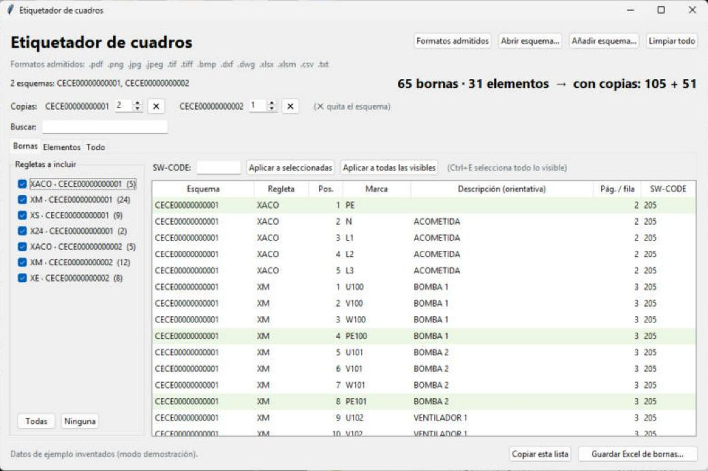
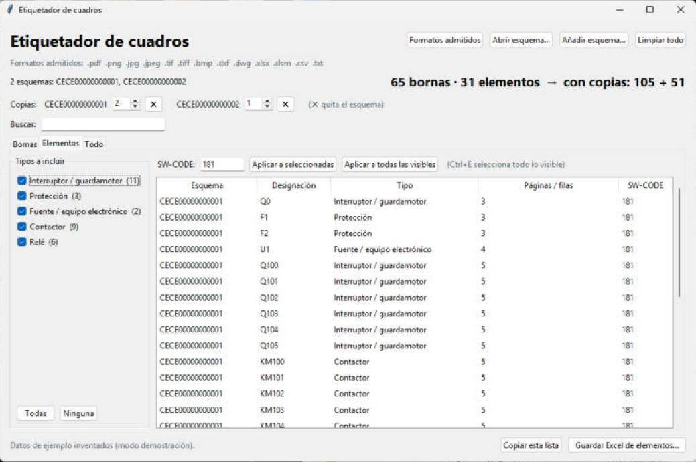
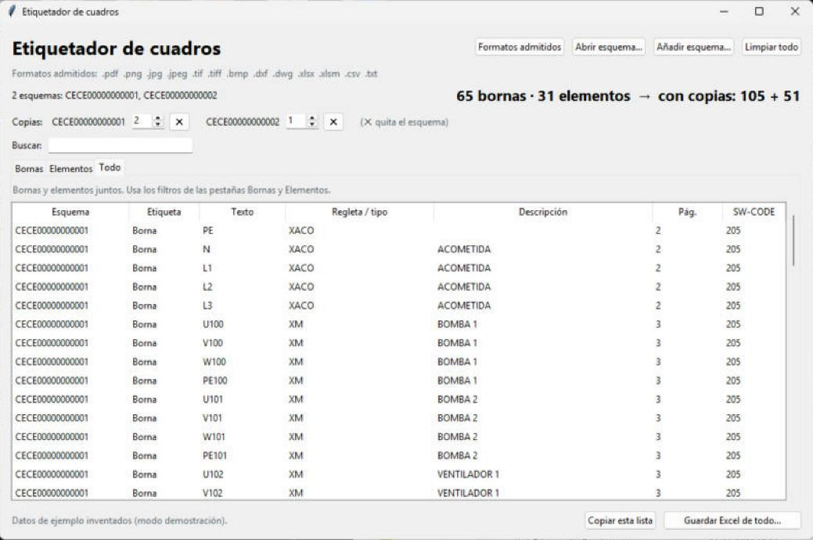
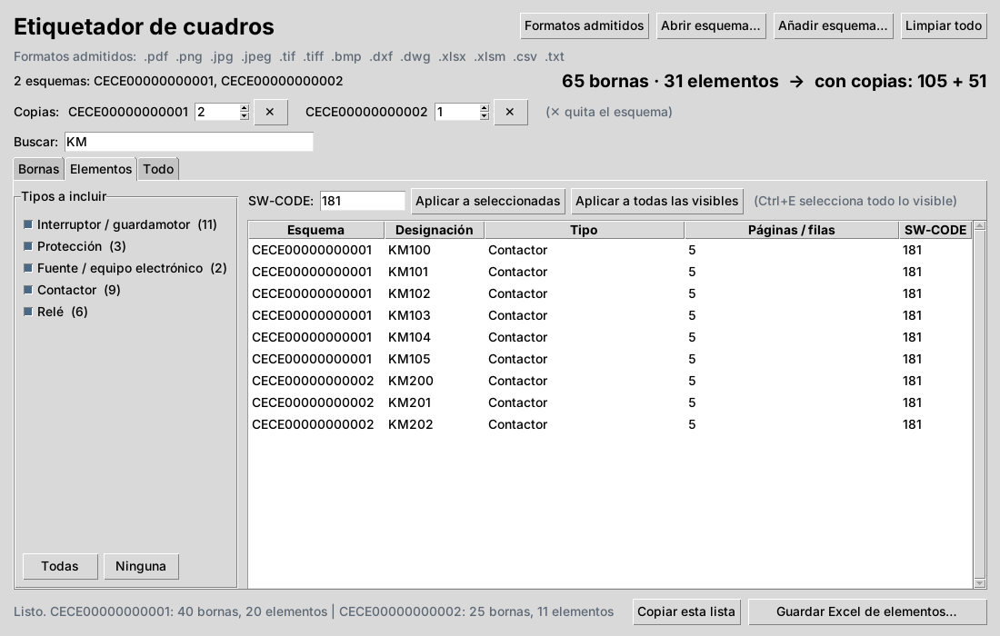
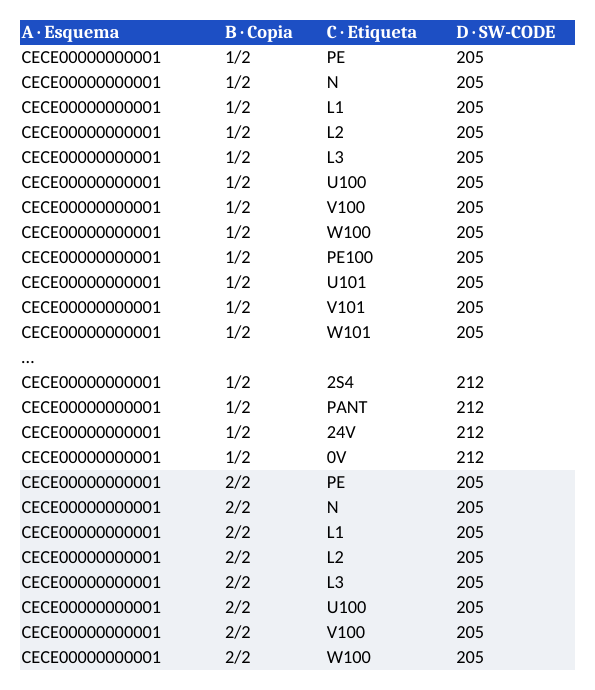
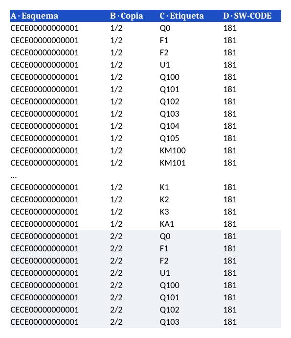

# Etiquetador de cuadros

Aplicación de escritorio para Windows que lee esquemas eléctricos y genera automáticamente las etiquetas de un cuadro (bornas y elementos de la placa) en un Excel. Sirve para cualquier software de impresión de etiquetas que importe datos desde Excel. Está probado con **Cembre GeniusPro**.

Evita copiar a mano cientos de marcas desde los planos: abres el esquema, revisas la lista y exportas.

## Capturas

> Capturas del programa en Windows en modo demostración (`--demo`), con datos de ejemplo inventados (esquemas CECE00000000001 y CECE00000000002); no corresponden a ningún esquema real.

**Bornas:** marcas de cada regleta, con su esquema, descripción y SW-CODE. Arriba, las copias por esquema y el total de etiquetas.



**Elementos de la placa:** interruptores, contactores, relés, protecciones… filtrables por tipo.



**Todo:** bornas y elementos juntos.



**Búsqueda:** por ejemplo, solo los contactores (KM).



**Excel generado (bornas):** el primer esquema con 2 copias seguidas; cada copia en su bloque. La etiqueta siempre en la columna C. (La fila azul es solo un rótulo de la captura: el Excel real no lleva cabecera.)



**Excel generado (elementos):**



## Qué hace

- **Bornas:** lee las páginas «Plano de bornes» (también en francés, inglés y alemán) y saca la marca de cada borna, su regleta, posición y una descripción orientativa.
- **Elementos de la placa:** detecta las designaciones de los aparatos cableados en la placa (Q, KM, K, F, ATS, U, R…), incluidas las que solo llevan letras (RS, KMN, QA, KR…). Descarta los de la puerta y los de fuera del armario (motores, pilotos, pulsadores, finales de carrera) y **no incluye las regletas de bornas (X…)**, que ya salen en la pestaña Bornas y no llevan etiqueta de elemento.
- **Orden de los elementos = plano de la placa (implantación):** se ordenan por filas de carriles, de arriba abajo, y de izquierda a derecha dentro de cada fila, para poder pegar las etiquetas seguidas sin buscarlas. Los que no salen en ese plano van después, en el orden de lectura del esquema.
- **Varios esquemas a la vez**, identificados por el número de instalación del cajetín. Se pueden añadir, quitar o limpiar sin cerrar el programa.
- **Copias por esquema:** repite las etiquetas de un esquema las veces que haga falta, en bloques seguidos.
- **SW-CODE:** asigna a cada etiqueta la referencia del consumible donde se imprime. Recuerda el valor de cada regleta para los siguientes esquemas.
- **Exportación a Excel** por pestaña (solo bornas, solo elementos o todo), sin cabeceras y con la etiqueta siempre en la columna C.

## Formatos admitidos

| Formato | Cómo se lee |
|---|---|
| PDF exportado del programa de esquemas | Texto del PDF (el más fiable) |
| PDF escaneado, PNG, JPG, TIF, BMP | Reconocimiento de texto (OCR) |
| DXF (AutoCAD) | Textos, MTEXT y atributos de bloques |
| DWG (AutoCAD) | Conversión previa con ODA File Converter |
| Excel / CSV | Listados de bornas o aparatos exportados (EPLAN, SEE Electrical, AutoCAD Electrical…) |

## Formato del Excel

Todas las hojas empiezan igual, sin fila de cabecera:

| A | B | C | D |
|---|---|---|---|
| Esquema | Copia | **Etiqueta** | SW-CODE |

Se puede importar en cualquier programa de etiquetas que lea Excel. Ejemplo probado con Cembre GeniusPro → *Importación → De Excel*: **Línea de inicio = 1**, **Valor inicial = [C]**, **Esquema = [A]**.

## Crear el ejecutable

Requisitos solo en el PC donde se compila:

- Windows con **Python 3.12 de 64 bits** (el OCR no funciona todavía con versiones más nuevas).
- Conexión a internet.

Después, doble clic en `crear_exe.bat`. El programa queda en `dist/EtiquetadorCuadros.exe`. Ese `.exe` funciona en cualquier PC con Windows sin instalar Python ni tener internet.

Para verlo funcionar con datos de ejemplo inventados (sin necesidad de esquemas):

```
EtiquetadorCuadros.exe --demo
```

Para probarlo sin ventana:

```
EtiquetadorCuadros.exe --prueba ESQUEMA.pdf
```

Deja un resumen en `ESQUEMA.pdf.prueba.txt`.

## Estructura del código

| Archivo | Función |
|---|---|
| `etiquetador.py` | Ventana (Tkinter): pestañas, filtros, copias, SW-CODE |
| `lectores.py` | Un lector por formato → páginas con textos y posiciones |
| `extraccion.py` | Detección de bornas, elementos, número de esquema y copias |
| `excel.py` | Generación de los Excel para GeniusPro |
| `config.py` | Ajustes recordados (SW-CODE por regleta) |
| `demo.py` | Datos de ejemplo inventados para el modo `--demo` |

## Tecnologías

Python · Tkinter · PyMuPDF · RapidOCR (ONNX Runtime) · ezdxf · openpyxl · PyInstaller

## Qué se ha probado y qué no

**Probado**

- PDF exportado con texto, de esquemas reales de la empresa (uno de ellos en francés): bornas, elementos, número de esquema, orden de la placa y exclusión de las regletas. Se comparó el resultado con las etiquetas que debían salir y con el plano de la placa.
- OCR con un escaneo simulado a partir de un PDF.
- DXF generados a partir de un PDF (resultado idéntico al del PDF).
- Listados Excel de ejemplo con formato tipo EPLAN.
- Compilación del `.exe` en Windows y apertura de esquemas con el `.exe`.

**Sin probar**

- Escaneos, DXF y DWG **reales** de la empresa.
- DWG: solo se ha comprobado el aviso cuando falta ODA File Converter, nunca con un DWG real.
- Listados reales de EPLAN, SEE Electrical o AutoCAD Electrical.
- Referencias de consumible (SW-CODE) por tipo de borna: no confirmadas.
- Esquemas con varias hojas de placa, o sin plano de placa, en cuanto al orden de los elementos.

## Limitaciones

- La descripción de cada borna es orientativa (el texto más cercano bajo la borna).
- El OCR puede equivocarse: revisa la lista antes de imprimir. En planos de armario escaneados solo se usa para saber la ubicación.
- La ubicación placa/puerta se basa en las páginas del armario y en el tipo de aparato; conviene revisar la lista de elementos.
- Las designaciones solo con letras se aceptan únicamente si empiezan por un tipo de placa conocido (K, KM, Q, F, ATS, U, R) y figuran en el plano de la placa; una designación con un prefijo nuevo puede no salir hasta añadirlo en `TIPOS`.
- Revisa los elementos poco habituales (por ejemplo KMC, KMI, REPN o KM22.1): salen porque encajan en esas reglas, pero solo tú sabes si llevan etiqueta.
- El orden por filas depende de la separación entre carriles (`GAP_FILA` en `extraccion.py`); con una placa muy distinta puede hacer falta ajustarlo.
- Solo lee PDF con texto o, con OCR, imágenes; la calidad del orden y de la detección baja con escaneos torcidos.

## Autor

Daniel Sancho Goñi
